# spectrapy

[](https://github.com/fdragowski480677/spectrapy/actions/workflows/ci.yml)
[](https://pypi.org/project/spectrapy-colour/)
[](https://pypi.org/project/spectrapy-colour/)

**Physically based spectral colour calculations and spectral plots — NumPy + matplotlib.**

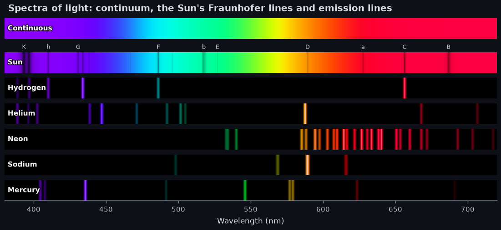

spectrapy turns physical descriptions of light — spectra of power versus wavelength — into colours,
and draws the figures that make spectra intuitive: spectra filled with the colours of their
wavelengths, spectroscope views, chromaticity diagrams, thin-film interference colours, the colours
of the sky, rainbows. It is a from-scratch, fully vectorized successor to the ideas of
[ColorPy](https://github.com/markkness/ColorPy) by Mark Kness.

- **Spectra as arrays.** `Spectrum` holds one spectrum or a batch of any shape on a common
  wavelength grid; `LineSpectrum` holds discrete lines as exact delta functions.
- **Colorimetry.** CIE 1931 2° and 1964 10° observers; XYZ by proper integration on any grid; CIE
  illuminants A, D50/55/65/75, any D-series CCT, E, FL1–FL12, the CIE LED series; Planck radiators.
- **Colour spaces.** sRGB, Display P3, Rec. 2020, Adobe RGB, with an explicit display pipeline:
  exposure, gamut mapping (OKLCh, desaturate, clip, …) and highlight handling.
- **Perceptual spaces.** CIELAB, CIELUV, OKLab, ΔE2000; the CIECAM02 and CAM16 colour appearance
  models with their uniform spaces; chromatic adaptation (Bradford, CAT02, CAT16, von Kries).
- **Light sources.** CCT and Duv for any observer, Planckian and daylight loci, the CIE 13.3 colour
  rendering index (Ra, R1–R14), and ANSI/IES TM-30 (Rf, Rg, hue-bin metrics, colour vector graphic).
- **Physics.** Multilayer thin films by the transfer-matrix method (oblique incidence, s/p,
  dispersive and absorbing materials), Rayleigh sky and sunset (with ozone), rainbows, prisms
  (exact ray tracing) and diffraction gratings, emission and Fraunhofer lines, reading measured
  spectra in nm/Å/µm/eV/cm⁻¹.
- **Plots.** Every function draws into an `ax` and returns it — nothing is saved or shown behind
  your back. Colour fills are images clipped to the curve (fast, seamless, small PDFs). Light and
  dark themes, plus a wavelength colormap for your own figures.
- **Wide gamut.** Render figures in Display P3 (or Rec. 2020, Adobe RGB). Saved PNGs carry an
  embedded ICC profile, so spectral colours show their full saturation on modern screens.
- **Interactive.** Slider-driven explorers for blackbodies and thin films, built on matplotlib
  widgets.
- **Validated.** 133 tests, cross-checked against [colour-science](https://www.colour-science.org),
  LittleCMS and physical laws. The full API is in [`docs/API.md`](https://github.com/fdragowski480677/spectrapy/blob/main/docs/API.md).

## Install

```bash
pip install spectrapy-colour
```

The PyPI name is `spectrapy-colour` because `spectrapy` was already taken there. The package you
import is still `spectrapy`:

```python
import spectrapy as sp
```

The latest development version installs straight from GitHub:

```bash
pip install "git+https://github.com/fdragowski480677/spectrapy.git"
```

For development:

```bash
git clone https://github.com/fdragowski480677/spectrapy.git
cd spectrapy
pip install -e ".[dev]"
pytest
```

Requires Python ≥ 3.10, NumPy and matplotlib. colour-science is only used by the tests.

## Quick start

```python
import numpy as np
import spectrapy as sp

sun = sp.blackbody(5772)                  # Spectrum: W sr⁻¹ m⁻² nm⁻¹ on 360–830 nm, 1 nm steps
sp.xyz(sun)                               # CIE XYZ; Y is luminance in cd/m²
sp.hex_color(sun)                         # '#fff1ea'
sp.cct(sp.xyz(sun))                       # (5772 K, Duv ≈ 0)

stars = sp.blackbody(np.linspace(2000, 20000, 300))   # a batch of 300 spectra
rgb = sp.color(stars)                     # (300, 3) displayable sRGB in one call

sp.cri(sp.illuminant("LED-B3"))           # CRIResult(Ra=84.9, R9=23.9, CCT=4102 K, Duv=-0.0006)
sp.tm30(sp.illuminant("LED-B3"))          # TM30Result(Rf=85.3, Rg=97.9, CCT=4103 K, Duv=-0.0007)

soap = sp.thinfilm.film(sp.thinfilm.WATER, 450)        # a 450 nm soap film in air
sp.hex_color(soap.reflectance(), brightness="max")      # '#00e2ff'

with sp.style.context("dark"):
    ax = sp.plot.spectrum(sun.normalize("max"))
    ax.set_title("The Sun as a 5772 K blackbody")
    sp.style.save(ax.figure, "sun.png")
```

For a guided tour with outputs, open the
[getting-started notebook](https://github.com/fdragowski480677/spectrapy/blob/main/examples/getting_started.ipynb).

## Gallery

The figures below are rendered by `python -m spectrapy.gallery --out gallery`. Use `--list` to
list them and `--only a,b` to render a subset. Every figure is a short function in
[`src/spectrapy/gallery.py`](https://github.com/fdragowski480677/spectrapy/blob/main/src/spectrapy/gallery.py), so read them as recipes.

**Blackbody radiation.** Planck spectra, the Wien peaks, the visible band, and the colour of a
blackbody versus temperature.

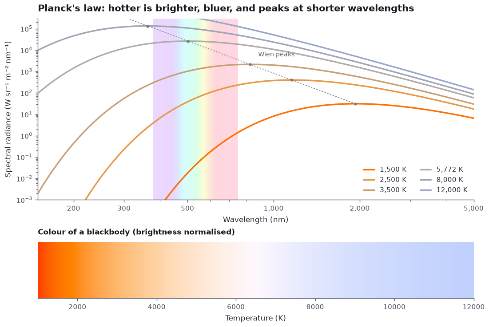

**The Sun.** A 5772 K photosphere with the classic Fraunhofer lines. The lines in the blue lower
the correlated colour temperature to about 5700 K.

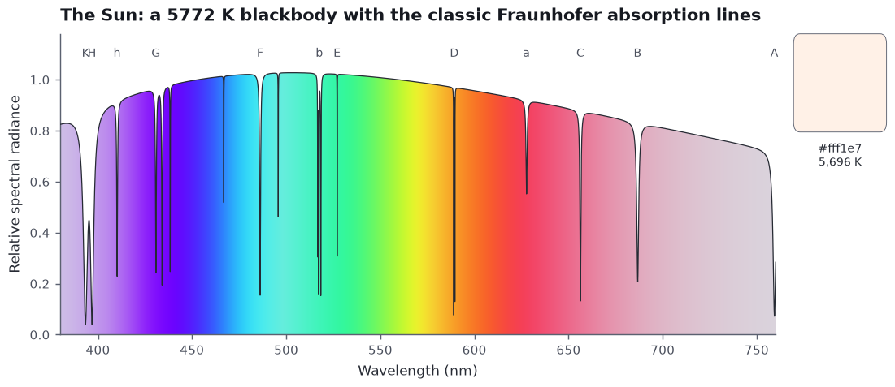

**Chromaticity diagrams.** CIE 1931 xy and CIE 1976 u′v′, with the sRGB, Display P3 and Rec. 2020
gamuts, the Planckian locus with isotemperature lines, and a few light sources.

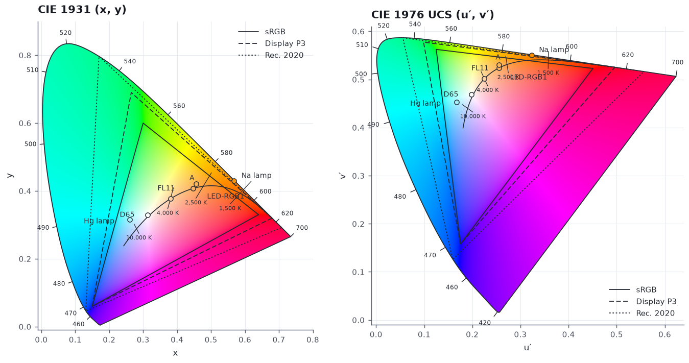

**Colour-matching functions.** The 2° (1931) and 10° (1964) standard observers.

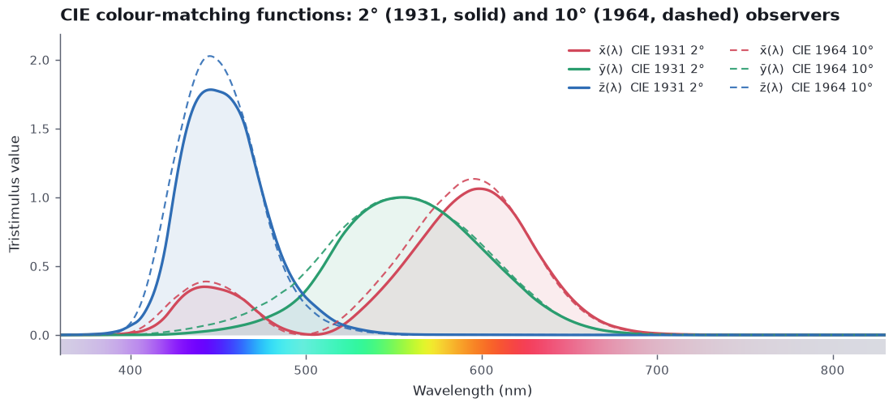

**Light sources.** Their colours, and the spectra of four CIE illuminants with their CRI.

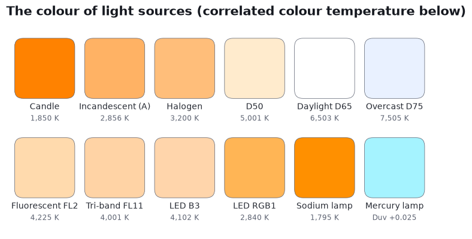
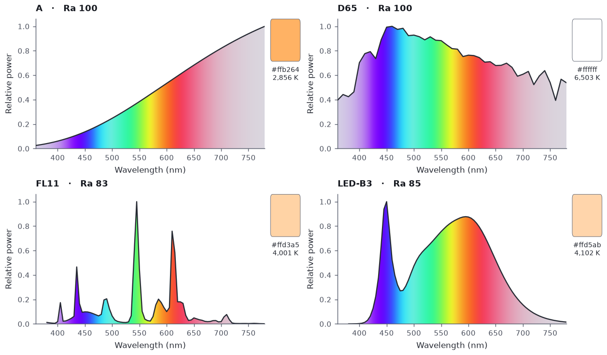

**Colour rendering.** The special indices R1–R14 of the CIE test samples, each bar drawn in its
sample's colour.

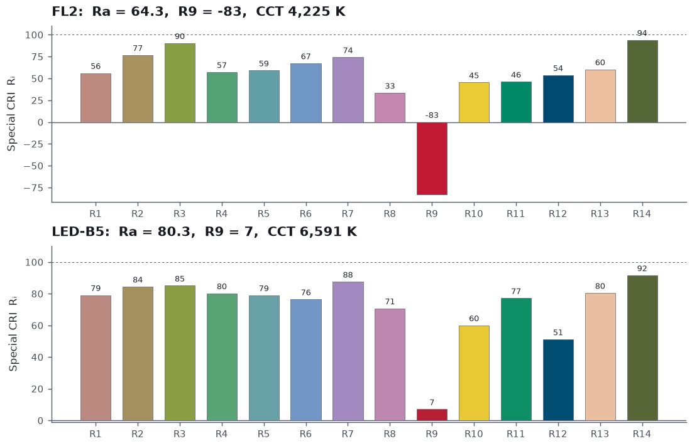

**ANSI/IES TM-30.** Colour vector graphics: the red polygon shows how the average colour of each
hue bin shifts relative to the reference illuminant (the circle). FL2 desaturates reds; the RGB
LED oversaturates them. Below is the one-page report: local chroma shift, hue shift and fidelity
per hue bin.

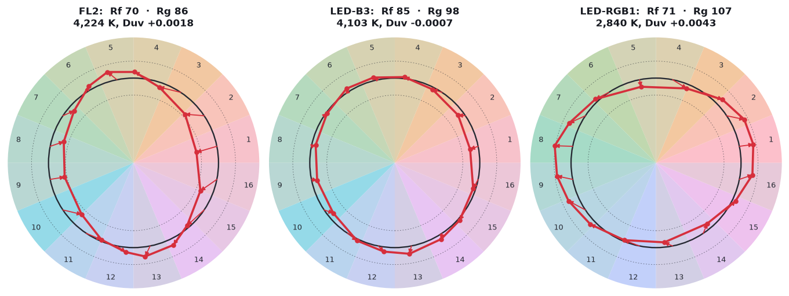
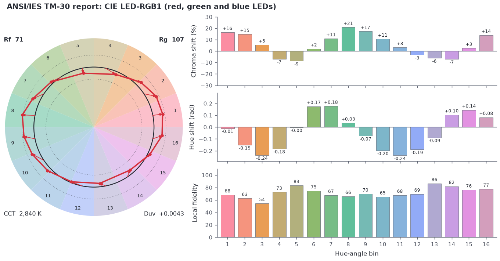

**Thin-film interference.** Soap film, oil on water, and the classic SiO₂-on-silicon oxide colour
chart, all from the transfer-matrix method.

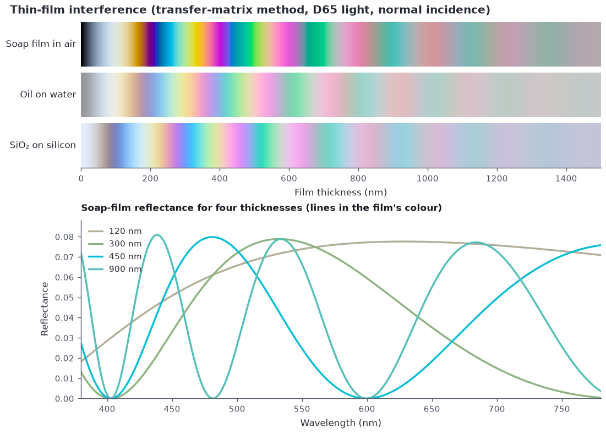

**Iridescence.** Soap-film colour versus thickness and viewing angle (unpolarised light).

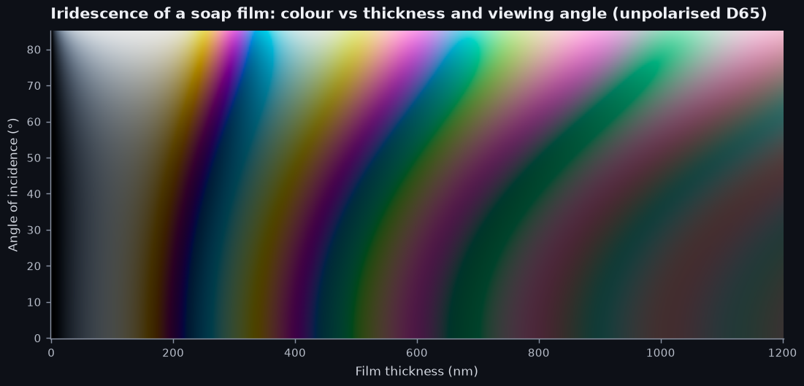

**Anti-reflection coatings.** Residual reflection on BK7 glass, and the tint it gives the coating.

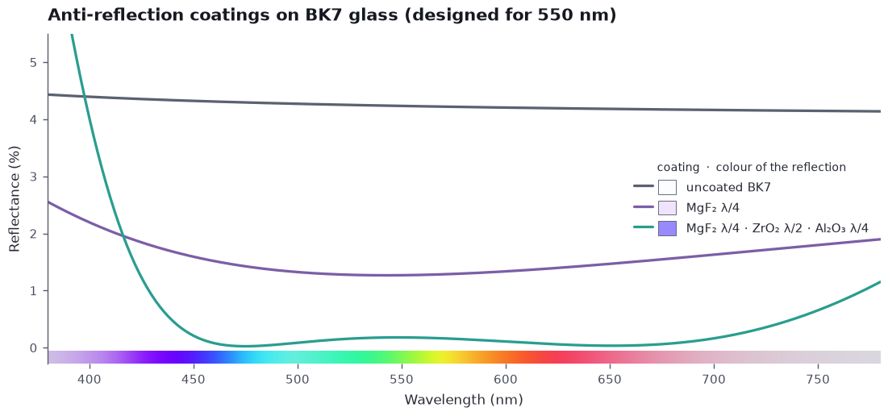

**Sky and sunset.** Rayleigh scattering reddens the setting sun; ozone absorption keeps the
twilight sky blue.

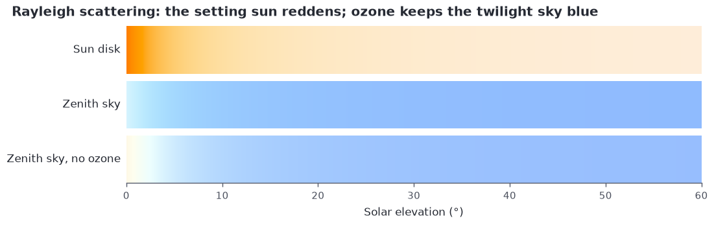

**Rainbow.** Computed from the dispersion of water (Descartes' minimum deviation) and the size of
the solar disk, with the primary and secondary bows and Alexander's dark band between them.

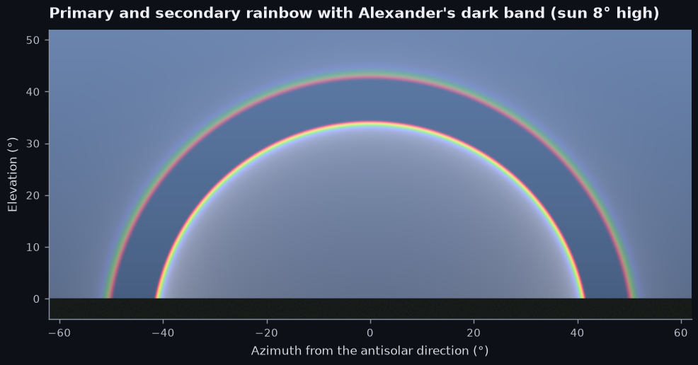

**Prism.** White light dispersed by a dense-flint (N-SF11) prism, traced exactly with Snell's law.
The screen shows the true distribution: violet is stretched out, red is compressed.

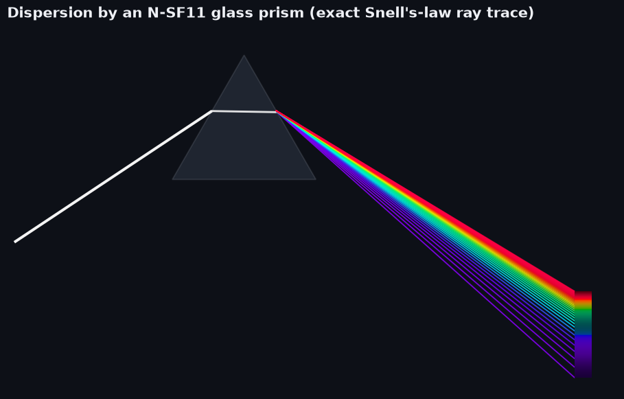

**Diffraction gratings.** The spectrum on a screen behind 300 and 600 lines/mm gratings, where the
2nd and 3rd orders overlap, and a mercury lamp repeating its lines in every order. Power per unit
screen length uses the exact Jacobian, so energy is conserved.

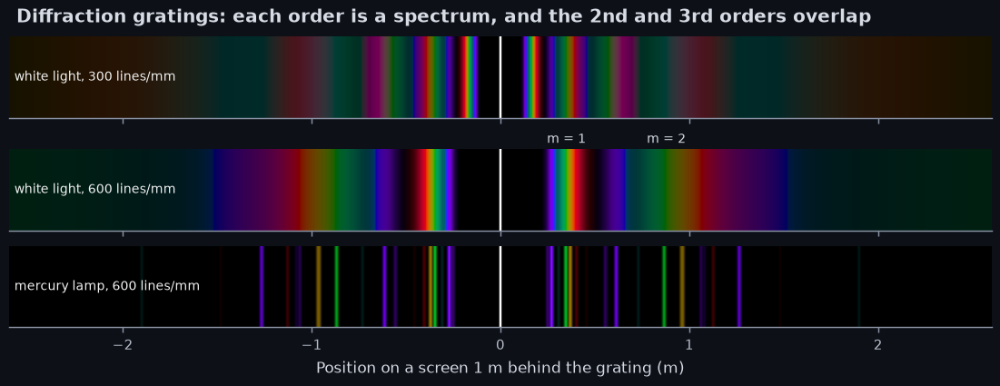

**Stars.** Colours of well-known stars from their effective temperatures, in the blackbody
approximation.

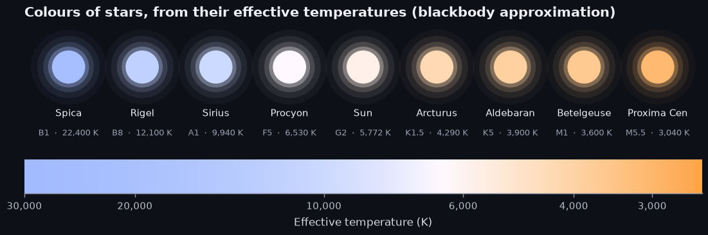

**Rendering spectral colours.** Monochromatic light lies outside every display gamut. spectrapy
reduces chroma at constant perceptual hue (OKLCh), then applies an 8 nm "spectroscope resolution"
blur. This removes the bright and dark bands that per-colour gamut mapping produces at the display
primaries.

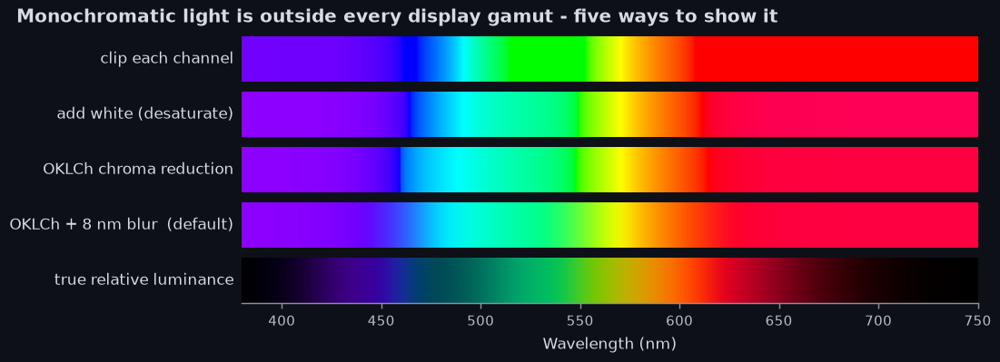

## Wide-gamut figures

Monochromatic light is far more saturated than sRGB can show. Most current phones, laptops and
monitors cover Display P3, and browsers, macOS, iOS and Windows colour-manage tagged images:

```python
with sp.output_space("p3"):                  # colours are computed in Display P3...
    fig = sp.plot.emission_atlas()
    sp.style.save(fig, "atlas_p3.png")       # ...and the PNG carries a Display P3 ICC profile
```

The gallery does the same with `python -m spectrapy.gallery --space p3`. The ICC v4 profiles are
generated by `spectrapy.icc`, and the test suite checks them against LittleCMS. Vector formats
(PDF, SVG) cannot carry the profile, so `save` warns there. Matplotlib's own colours (text, axes)
are neutral greys and are unaffected.

## Interactive explorers

```python
ex = sp.interactive.blackbody_explorer()     # temperature slider: spectrum, colour, CCT
ex = sp.interactive.thinfilm_explorer()      # thickness / angle / index sliders
ex.show()                                     # needs an interactive backend (e.g. %matplotlib widget)
```

## Conventions

| Topic | Convention |
|---|---|
| Wavelengths | nanometres, ascending; air wavelengths for line lists |
| Batches | `Spectrum.values` has shape `(..., n)`; the last axis follows the wavelengths |
| `kind="emission"` | spectral density per nm; zero outside its sampled range |
| `kind="reflectance"`/`"transmittance"` | factors that need an illuminant (default D65); end values are held outside the sampled range (CIE 015 practice) |
| Emission XYZ | `k ∫ S x̄ dλ` with `k = K_m = 683.002 lm/W`, so `Y` is luminance [cd/m²] for radiance input |
| Object XYZ | relative to the illuminant, with a perfect white at `Y = 1` |
| Integration | trapezoid rule on the union of the spectrum's and the observer's grids, so results do not depend on sampling (a plain sum would) |
| Lines | exact delta functions `Σ Pᵢ cmf(λᵢ)`; broadened only for drawing |
| Planckian locus / CCT | integrated with the observer, `c₂ = 1.4388e-2 m·K` (CIE 015); blackbody radiance itself uses CODATA constants |
| Duv | signed distance from the Planckian locus in CIE 1960 uv, positive above the locus |

**Displaying colours.** `RGBColorSpace.to_display(xyz, brightness=..., gamut=..., highlights=...)` and
`sp.color(...)` run five steps:
1. XYZ → linear RGB.
2. Gamut mapping:
   - `"oklch"` (default) reduces chroma at constant OKLab lightness and hue.
   - `"desaturate"` adds white light of equal luminance.
   - `"clip"`, `"uniform"` and `"smooth"` are also available.
3. Brightness:
   - `None` keeps the absolute scale (`Y = 1` is display white).
   - `"max"` makes each colour as bright as possible.
   - `"global"` scales all colours together.
   - A number sets the luminance.
4. Highlights: `"scale"`, `"whiten"` (camera-like) or `"clip"`.
5. Encoding with the transfer function.

`sp.color` picks `"max"` for light sources and keeps true lightness for objects.

## Vectorization

Everything broadcasts over batch axes: hundreds of spectra become one matrix product with the
colour-matching functions, and thin-film stacks broadcast over wavelength × angle × thickness. Large
maps are computed in chunks that are reduced to XYZ immediately, so the full spectral cube never sits
in memory. Measured on the development machine:

| Task | Time |
|---|---|
| 300 blackbody colours (spectrum → XYZ → sRGB) | 4 ms |
| 800 soap-film colours (transfer matrix + colour) | 0.11 s |
| CRI of a light source | 4 ms |
| 10 000 CCT + Duv | 0.27 s |

The API reference, generated from the docstrings by `tools/make_api_docs.py`, is in
[`docs/API.md`](https://github.com/fdragowski480677/spectrapy/blob/main/docs/API.md).

## Modules

| Module | Contents |
|---|---|
| `spectrapy.spectrum` | `Spectrum`, `LineSpectrum`, wavelength grids |
| `spectrapy.observers` | CIE 1931 2° and 1964 10° colour-matching functions |
| `spectrapy.illuminants` | Planck's law, D series, CIE standard and LED/FL illuminants |
| `spectrapy.colorimetry` | `xyz`, chromaticity coordinates, dominant wavelength, `color`, `hex_color` |
| `spectrapy.colorspaces` | RGB colour spaces, transfer functions, gamut mapping |
| `spectrapy.uniform` | CIELAB, CIELUV, OKLab, LCh, ΔE76, ΔE2000 |
| `spectrapy.adaptation` | chromatic adaptation transforms |
| `spectrapy.temperature` | CCT, Duv, Planckian and daylight loci, isotherms |
| `spectrapy.quality` | CIE 13.3 colour rendering index, ANSI/IES TM-30 / CIE 224:2017 |
| `spectrapy.appearance` | CIECAM02, CAM16, CAM02-UCS and CAM16-UCS |
| `spectrapy.lines` | line profiles, emission line lists, Fraunhofer lines, solar spectrum |
| `spectrapy.thinfilm` | transfer-matrix method, `Stack`, dispersion models, materials |
| `spectrapy.atmosphere` | Rayleigh optical depth, air mass, direct sunlight, zenith sky |
| `spectrapy.optics` | rainbow angles and spectra, prism ray tracing, diffraction gratings |
| `spectrapy.render` | spectral colours, spectroscope strips (arrays, no matplotlib) |
| `spectrapy.io` | reading and writing spectra, unit conversion with Jacobians |
| `spectrapy.icc` | ICC v4 profiles for the RGB colour spaces |
| `spectrapy.plot` | all plotting functions |
| `spectrapy.style` | light and dark themes, `save` |
| `spectrapy.cmap` | wavelength colormap |
| `spectrapy.interactive` | slider-driven explorers |

## Validation

`pytest` runs 133 tests.

Against colour-science:
- colour-matching tables identical.
- Illuminant XYZ agrees to 3e-4.
- RGB colour-space matrices and the sRGB transfer function agree.
- Lab, Luv and OKLab agree to 1e-6.
- ΔE2000 matches, including the Sharma et al. (2005) test pairs.
- All chromatic adaptation transforms match.
- CCT agrees with Ohno (2013) to 1e-4.
- CRI Ra agrees to within 0.1.
- CIECAM02 and CAM16 correlates (and the inverse CAM16) agree to 1e-9.
- TM-30 agrees: Rf and Rg to 0.02, and every hue-bin metric.

Against physics:
- Stefan–Boltzmann law (1e-4) and Wien's displacement law.
- Fresnel equations, Brewster's angle and total internal reflection.
- The Airy formula for an absorbing film.
- Energy conservation R + T = 1 (1e-12).
- Quarter-wave coating theory.
- Glass dispersion against datasheet values.
- Rayleigh optical depth (Bodhaine et al. 1999).
- Rainbow angles and prism minimum deviation.
- The prism ray trace against the analytic deviation formula.
- Energy conservation of the grating screen projection.

Against LittleCMS (through Pillow): the generated ICC profiles convert colours exactly as
spectrapy does, to within 8-bit rounding.

## Data and credits

- Colour-matching functions and illuminants A and D65: [CVRL](http://www.cvrl.org). Daylight basis
  functions, FL and LED illuminants, the CRI test colour samples and the 99 TM-30 / CIE 224 colour
  evaluation samples are CIE tables, taken from colour-science (BSD-3-Clause). Sources are listed in
  [`src/spectrapy/data/README.md`](https://github.com/fdragowski480677/spectrapy/blob/main/src/spectrapy/data/README.md), and `tools/build_data.py`
  regenerates the tables.
- Emission and Fraunhofer line wavelengths follow the NIST Atomic Spectra Database. **Relative
  intensities, Fraunhofer line strengths and the silicon optical constants are approximate**:
  they are meant for illustration.
- Inspired by [ColorPy](https://github.com/markkness/ColorPy) by Mark Kness (LGPL-3.0).
- Methods: CIE 015:2018 (colorimetry); CIE 13.3-1995 (CRI); CIE 224:2017 and ANSI/IES TM-30
  (colour rendition); CIE 159:2004 (CIECAM02); Li et al. 2017 (CAM16); Ohno 2014 (CCT/Duv); Sharma, Wu & Dalal
  2005 (CIEDE2000); Ottosson 2020 (OKLab); Born & Wolf / Macleod (thin films); Bodhaine et al. 1999
  and Kasten & Young 1989 (atmosphere); Hulburt 1953 (ozone and the twilight sky); Malitson 1965
  (fused silica); Green 2008 (silicon).

## License

spectrapy is free software under the **GNU Lesser General Public License v3.0 or later**: see
[`COPYING.LESSER`](https://github.com/fdragowski480677/spectrapy/blob/main/COPYING.LESSER) and [`COPYING`](https://github.com/fdragowski480677/spectrapy/blob/main/COPYING). You can use it from any program,
including closed-source ones. Changes to spectrapy itself must be shared under the same licence.
